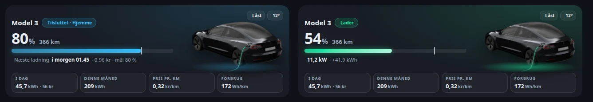

# HA Tesla Glance Card

`custom:ha-tesla-glance-card` is a small front page card for one car: battery, range, charging, lock, cable, inside temperature and consumption at a glance. It only shows data and never controls the car. A tap opens `navigation_path` (for example the full Tesla page) or the battery's more-info.



- The battery bar marks the charge target (`target_soc`, an entity or a number).
- While charging the bar flows green and the line shows power, added energy and the finish time.
- When the car is not charging, the line shows the next planned charge from your charge planner.
- Below 20 % the card turns orange, and an unlocked car shows an orange chip.
- The car image switches to `image_charging` while the cable is in or the car charges. Transparent images work best.
- Stat tiles appear only for the entities you set. Narrow cards show them in two columns.
- `compact: true` places the stat tiles 2×2 beside the battery, so the card is about 40 % lower.

Every option is optional except `battery`. All entity options can be set in the visual editor.

```yaml
type: custom:ha-tesla-glance-card
name: Model 3
compact: false
navigation_path: /lovelace/tesla
image: /local/tesla/parked.webp
image_charging: /local/tesla/charging.webp
battery: sensor.model_3_battery_level
range: sensor.model_3_battery_range
charging: sensor.model_3_charging          # "charging", or a binary sensor
charger_power: sensor.model_3_charger_power
energy_added: sensor.model_3_charge_energy_added
charge_finish: sensor.model_3_time_to_full_charge   # timestamp, optional
plugged: binary_sensor.model_3_charge_cable
lock: lock.model_3_lock
sentry: switch.model_3_sentry_mode
inside_temperature: sensor.model_3_inside_temperature
location: device_tracker.model_3_location
target_soc: sensor.charge_plan_target_soc   # or a number, e.g. 80
next_charge_start: sensor.charge_plan_next_start
next_charge_cost: sensor.charge_plan_cost
energy_today: sensor.model_3_home_charging_energy_today
cost_today: sensor.model_3_home_charging_cost_today
energy_month: sensor.model_3_home_charging_energy_this_month
cost_per_km: sensor.model_3_cost_per_km
efficiency: sensor.model_3_efficiency
```

The car images from the [Tesla dashboard card](../th-tesla-dashboard-card) fit this card: copy `parked.webp` and `charging.webp` to `/config/www/tesla/`.
