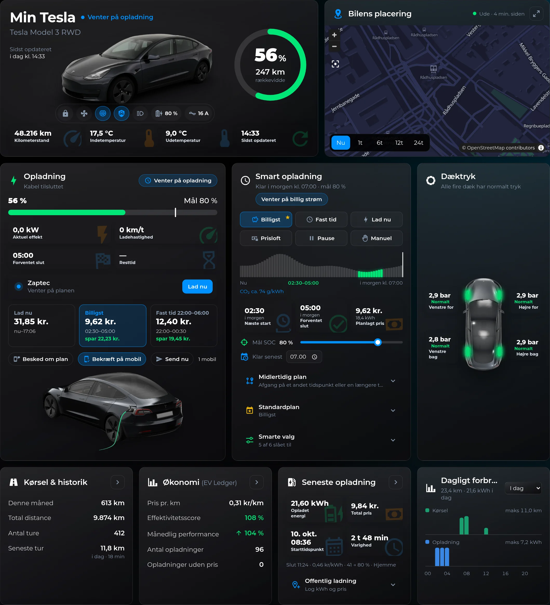
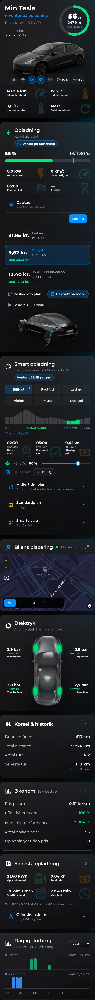

# TH Tesla Dashboard Card

`custom:th-tesla-dashboard-card` er et samlet Tesla-dashboard i ét kort:
bilstatus med batteriring, Home Assistants eget kort med bilens placering,
opladning (Monta/Zaptec), smart ladeplan, dæktryk, kørsel, økonomi (EV Ledger),
seneste opladning og en let graf over dagligt forbrug.



<details>
<summary>Samme side på mobil</summary>



</details>

Skærmbillederne er taget med eksempeldata. Bilbillederne ligger i [`images/`](images) – se
[Hele Tesla-siden](#hele-tesla-siden) for, hvordan du bruger dem.

- Vanilla Web Component uden afhængigheder. Skyggeroden bygges én gang og
  opdateres derefter målrettet, når en overvåget entity ændrer sig.
- Ingen polling. Grafens statistik hentes via `recorder/statistics_during_period`,
  kun når kortet er synligt, og caches i 15 minutter.
- Kortet over placeringen er HA's indbyggede `map`-kort via `loadCardHelpers()`. Med
  `map.style: satellite` (eller knappen i kortets hoved) lægges Esri-satellitfotos ind i
  HA's eget kort, så markør, rute, zoom og more-info virker som før.
- Alle entities er valgfrie. Manglende eller utilgængelige værdier vises som `—`.
  En kontrol uden en fungerende entity skjules helt.
- Enheder kommer fra `unit_of_measurement`. Dæktryk omregnes kun, når sensorens
  egen enhed er kendt (bar, psi, kPa, …).

## Eksempel

```yaml
type: custom:th-tesla-dashboard-card
name: Min Tesla
vehicle:
  model: Tesla Model 3 RWD
  image: /local/tesla/model-3-rwd.webp   # transparent WebP/PNG/SVG, valgfri
  photos:                                # fotos af bilen, valgfri
    charging: /local/tesla/plugged-in.webp # med ladekabel: i Opladning og i lade-popuppen
    parked: /local/tesla/parked.webp       # uden kabel: i Opladning
    top: /local/tesla/top.webp             # bilen set ovenfra (front op): i Dæktryk
    top_wheels: { fl: [13, 19], fr: [87, 19], rl: [13, 79], rr: [87, 79] }   # hjulenes placering i %
    cable: { path: "M524 252 L…", width: 889, height: 504 }  # kablet i ladefotoet: animeres under ladning
car_controls:                            # Bilstyring: runde knapper nederst i topkortet (kun på hele Tesla-siden)
  lock: lock.tesla_lock                  # oplåsning kræver to tryk
  climate: climate.tesla_climate         # lille termostat: tænd/sluk og temperatur ± (+ "Flere indstillinger")
  charge_port: cover.tesla_charge_port_door   # to tryk
  sentry: switch.tesla_sentry_mode       # slå fra kræver to tryk
  flash: button.tesla_flash_lights
  charge_limit: number.tesla_charge_limit
  charge_current: number.tesla_charge_current   # ladegrænse og -strøm: skyder i det lille panel
location_entity: device_tracker.tesla_location_tracker
entities:
  battery: sensor.tesla_battery
  range: sensor.tesla_range
  odometer: sensor.tesla_odometer
  temperature_inside: sensor.tesla_temperature_inside
  temperature_outside: sensor.tesla_temperature_outside
  last_update: sensor.tesla_data_last_update_time
  online: binary_sensor.tesla_online
  asleep: binary_sensor.tesla_asleep
  charger: binary_sensor.tesla_charger
  charging: binary_sensor.tesla_charging
  charging_rate: sensor.tesla_charging_rate
  tpms_front_left: sensor.tesla_tpms_front_left
  tpms_front_right: sensor.tesla_tpms_front_right
  tpms_rear_left: sensor.tesla_tpms_rear_left
  tpms_rear_right: sensor.tesla_tpms_rear_right
  daily_energy: sensor.tesla_daily
  charging_finish_time: sensor.tesla_charging_finish_time
  charging_time_remaining: sensor.tesla_charging_time_remaining
  charging_price_estimate: sensor.tesla_charging_price_estimate
  charger_power: sensor.wallbox_power_kw
  charger_mode: sensor.wallbox_charger_mode
  best_charge_start: sensor.tesla_best_charge_start_text_by_deadline
  best_charge_end: sensor.tesla_best_charge_end_text_by_deadline
  best_charge_price: sensor.tesla_best_charge_price_by_deadline
  charge_minutes_needed: sensor.tesla_charge_minutes_needed
  missing_wall_kwh: sensor.tesla_missing_wall_kwh
  efficiency_score: sensor.tesla_battery_efficiency_score
  trips: sensor.tesla_trips
  last_trip: sensor.tesla_last_trip
  total_distance: sensor.tesla_total_distance
  cost_per_km: sensor.tesla_cost_per_km
  monthly_performance: sensor.tesla_monthly_performance
  charges: sensor.tesla_charges
  last_charge: sensor.tesla_last_charge
  charges_needing_price: sensor.tesla_charges_needing_price
  monta_state: sensor.monta_charger_state
  monta_last_charge: sensor.monta_charger_last_charge
  monta_last_meter_reading: sensor.monta_charger_last_meter_reading
  monta_wallet: sensor.monta_personal_wallet
  monta_latest_wallet_transactions: sensor.monta_latest_wallet_transactions
  monta_charge_energy: sensor.monta_charger_charge_energy
  monta_cable_connected: binary_sensor.monta_charger_cable_plugged_in
controls:
  start_charge: { entity: script.charger_start }   # eller switch/button
  stop_charge: { entity: script.charger_stop }
  target_soc: { entity: input_number.tesla_target_soc }
  deadline: { entity: input_datetime.tesla_ready_by_time }
tpms:
  unit: bar            # visningsenhed; omregnes fra sensorens egen enhed
map:
  theme_mode: dark     # auto | light | dark
  style: satellite     # default | satellite
  hours_to_show: 6
refresh_entities:      # bedes opdatere, når kortet vises (højst én gang i minuttet)
  - sensor.monta_charger_state
chart:
  energy_entity: sensor.monta_charger_charge_energy
```

Bilstyringen ligger som en række runde knapper nederst i topkortet, så kortet ikke bliver større. Et tryk viser straks,
at kommandoen er sendt ("Låser…", "Starter klima…" med en roterende ring), og knappen kan ikke trykkes igen, før bilen
har svaret (eller efter 90 sekunder: "svarede ikke").

## Billede af bilen

Kortet tegner selv bilen: én enkel sidevisning pr. Tesla-karrosseri (`model_3`,
`model_3_highland`, `model_y`, `model_y_juniper`, `model_s`, `model_x`, `cybertruck`,
`roadster`) i farverne `grey` (standard), `black`, `white`, `silver`, `blue` og `red`.

```yaml
vehicle:
  model: auto        # navn og karrosseri fra EV Smart Charge (smart_charge)
  color: white
  # body: model_y    # vælg karrosseriet selv
```

Med `smart_charge` og `model: auto` (eller uden `model`) bruger kortet den model, EV Smart
Charge har fundet eller fået valgt for bilen. Teslas egne fotos må ikke distribueres her, men
[`images/`](images) har renderede billeder af en grå Model 3 RWD, som følger med (se [Hele Tesla-siden](#hele-tesla-siden)).
Vil du have din egen bil på kortet:

1. Læg et billede med transparent baggrund (WebP/PNG/SVG, ca. 900×434) i
   `config/www/`, fx `config/www/tesla/min-bil.webp`.
2. Sæt `vehicle.image: /local/tesla/min-bil.webp` (`/local/` = `config/www/`).
3. Genindlæs dashboardet (evt. tøm browserens cache).

Gennemsigtige fotos (WebP/PNG) vises som topbilledet med skygge; JPEG-fotos med egen baggrund toner ud mod
kanterne (bedst er at fjerne baggrunden). Opladning-panelet viser
fotoet med kabel, når bilen er sat til, ellers det parkerede, og lade-popuppen (`layout: charge`) bruger fotoet med
kabel som topbillede, mens bilen er sat til.

## Hele Tesla-siden

Siden på skærmbillederne er en skjult visning (`subview: true`) med `custom:grid-layout`
([layout-card](https://github.com/thomasloven/lovelace-layout-card)): Tesla-kortet i fuld bredde, lidt luft
og en navigationsbjælke nederst. Bilbillederne er renderede billeder af en Model 3 RWD i grå uden nummerplade.

1. Kopiér de fire billeder fra [`images/`](images) til `config/www/tesla/`:

   | Fil | Bruges til |
   |---|---|
   | `model-3-rwd-charcoal.webp` | Topbilledet (`vehicle.image`) |
   | `charging.webp` | Bilen med ladekabel i Opladning og lade-popuppen (`photos.charging`) |
   | `parked.webp` | Bilen uden kabel i Opladning (`photos.parked`) |
   | `top.webp` | Bilen set ovenfra i Dæktryk (`photos.top`) |

2. Opret en ny visning (rediger dashboard → ⋮ → Raw configuration editor) og indsæt visningen nedenfor.
   Skift `min_tesla`/`hjemmelader` ud med dine egne entiteter. `top_wheels` og `cable` passer til netop disse billeder.

```yaml
type: custom:grid-layout
path: tesla
title: Tesla
icon: mdi:ev-plug-ccs1
subview: true
layout:
  margin: 0 auto
  width: 100%
  max-width: 1500px
  grid-template-columns: minmax(0, 1fr)
  place-content: center
  padding: 0 10px 24px 10px
cards:
  - type: custom:th-tesla-dashboard-card
    name: Min Tesla
    vehicle:
      model: auto
      image: /local/tesla/model-3-rwd-charcoal.webp
      photos:
        charging: /local/tesla/charging.webp
        parked: /local/tesla/parked.webp
        top: /local/tesla/top.webp
        top_wheels: { fl: [12.8, 18.9], fr: [87.1, 18.9], rl: [12.5, 79.2], rr: [87.4, 79.1] }
        cable:
          width: 889
          height: 504
          path: >-
            M524.0 252.0 L519.0 258.0 L513.2 264.0 L507.9 270.0 L503.6 276.0 L500.4 282.0 L498.0 288.0
            L496.0 294.0 L494.1 300.0 L492.4 306.0 L490.5 312.0 L488.8 318.0 L487.4 324.0 L486.0 330.0
            L484.5 336.0 L483.0 342.0 L481.6 348.0 L480.5 354.0 L479.5 360.0 L478.2 366.0 L476.8 372.0
            L475.5 378.0 L474.2 384.0 L472.8 390.0 L471.5 396.0 L470.2 402.0 L468.8 408.0 L467.2 414.0
            L465.8 420.0 L464.2 426.0 L462.4 432.0 L460.1 438.0 L457.6 444.0 L453.8 450.5 L448.1 457.4
            L442.0 463.1 L436.0 467.2 L430.0 470.5 L424.0 473.4 L418.0 476.0 L412.0 478.2 L406.0 480.1
            L400.0 482.0 L394.0 483.8 L388.0 485.1 L382.0 486.4 L376.0 487.6 L370.0 488.9 L364.0 490.0
    location_entity: device_tracker.min_tesla_location_tracker
    smart_charge: select.min_tesla_charge_mode   # EV Ledger: finder resten selv
    charger_label: Zaptec
    entities:
      battery: sensor.min_tesla_battery
      range: sensor.min_tesla_range
      odometer: sensor.min_tesla_odometer
      temperature_inside: sensor.min_tesla_temperature_inside
      temperature_outside: sensor.min_tesla_temperature_outside
      last_update: sensor.min_tesla_data_last_update_time
      online: binary_sensor.min_tesla_online
      asleep: binary_sensor.min_tesla_asleep
      charger: binary_sensor.min_tesla_charger
      charging: binary_sensor.min_tesla_charging
      charging_rate: sensor.min_tesla_charging_rate
      tpms_front_left: sensor.min_tesla_tpms_front_left
      tpms_front_right: sensor.min_tesla_tpms_front_right
      tpms_rear_left: sensor.min_tesla_tpms_rear_left
      tpms_rear_right: sensor.min_tesla_tpms_rear_right
      daily_energy: sensor.min_tesla_distance_today
      charger_power: sensor.min_tesla_home_charging_power
      charger_mode: sensor.hjemmelader_charger_mode
      efficiency_score: sensor.min_tesla_battery_efficiency_score
      trips: sensor.min_tesla_trips
      last_trip: sensor.min_tesla_last_trip
      total_distance: sensor.min_tesla_total_distance
      cost_per_km: sensor.min_tesla_cost_per_km
      monthly_performance: sensor.min_tesla_monthly_performance
      charges: sensor.min_tesla_charges
      last_charge: sensor.min_tesla_last_charge
      charges_needing_price: sensor.min_tesla_charges_needing_price
    car_controls:
      lock: lock.min_tesla_lock
      climate: climate.min_tesla_climate
      charge_port: cover.min_tesla_charge_port_door
      sentry: switch.min_tesla_sentry_mode
      flash: button.min_tesla_flash_lights
      charge_limit: number.min_tesla_charge_limit
      charge_current: number.min_tesla_charge_current
    controls: {}
    tpms:
      unit: bar
    chart:
      energy_entity: sensor.hjemmelader_energy_meter
    map:
      theme_mode: dark
      style: satellite
  - type: custom:gap-card        # luft over navigationsbjælken (valgfri, gap-card fra HACS)
    height: 150
  - type: custom:ha-navbar-card  # valgfri bundmenu (med i denne pakke)
    config_url: /local/ha-navbar-card/navbar.json
```

Med EV Ledger kan hele `entities`-blokken også undværes (se næste afsnit).

## EV Ledger: hele kortet fra én linje

Med integrationen [EV Ledger](https://github.com/MRDonnii/evledger) (HACS) er én linje nok til hele kortet:

```yaml
type: custom:th-tesla-dashboard-card
name: Min Tesla
ev_ledger: select.min_bil_charge_mode   # en vilkårlig entity fra bilens EV Ledger-enhed
```

Kortet finder så selv:

- EV Ledgers egne entiteter: smart opladning, ture, opladninger, økonomi, km i dag, laderens effekt og kWh.
- Bilens egne entiteter ved siden af den batterisensor, EV Ledger læser: batteri, rækkevidde, kilometertæller,
  temperaturer, kabel, dæktryk og placering. Det virker for Tesla Fleet, Teslemetry og Tessie (oversættelsesnøgler)
  og Tesla Custom (entity-navne). Kører bilen i to integrationer, bruges enheder med samme navn.
- Laderens tilstand ved siden af laderens effektsensor.
- Grafen over dagligt forbrug: kørsel fra kilometertælleren og opladning fra EV Ledgers kWh.

Det samme gælder med `smart_charge`: kortet finder altid selv det, der ikke er sat med hånden. Det, der sættes under
`entities`, vinder over det fundne. Bilens knapper (`car_controls`) sættes stadig med hånden.

**Ladeudgifter:** Et panel under de andre viser, hvad opladningen har kostet pr. måned de seneste 12 måneder
(hjemme og ude i hver sin farve, denne måned fremhævet) og årets samlede udgift i kr. med kWh og pris pr. kWh. Hold
musen over en måned for kr., kWh, kr/kWh og antal ladninger. Det kommer fra EV Ledgers "Ladeudgift i år"
(EV Ledger 0.5.0 eller nyere) og vises kun, når den findes. Med EV Ledger 0.5.1 eller nyere står samme måned året
før som en svag søjle ved siden af, og sidste års total vises under grafen.

**Klar senest (ugeplan og engangstid):** Med EV Ledger 0.6.0 eller nyere viser "Klar senest" den næste klar-tid med
dagens mål og hvor den kommer fra (Ugeplan, Engangstid, Lærte afgange, Samme tid hver dag). Et tryk åbner en popup:

- **Engangstid:** én bestemt gang (dato, tid og evt. eget mål). Bruges én gang, derefter gælder den normale plan igen.
- **Normal plan:** "Samme tid hver dag" (med anden tid i weekenden) eller **Ugeplan** med tid og mål pr. dag og fri
  dage, "Mandag til alle hverdage" og "Brug lærte afgange".

Popuppen er en rigtig dialog over hele siden (Esc eller tryk udenfor lukker), og intet gemmes før "Gem plan".

**Hold batteriet på målet under opvarmning:** I klima-popuppen (EV Ledger 0.6.4 eller nyere) slår en kontakt til, at
laderen holder batteriet på målet, mens bilen varmes og er sat til laderen, og et felt sætter den højeste pris pr. kWh.
Linjen under fortæller, om den lader nu, eller hvorfor ikke (fx "Venter: strømmen koster 2,42 kr (højst 2,00 kr)").

**Mål SOC skal bekræftes:** Når skyderen slippes, sendes det nye mål først efter **Bekræft** ("Nyt mål 85 % (nu 80 %)",
med Fortryd). Uden svar glemmes det efter 20 sekunder.

**Kompakt visning (`layout: charge`):** Forsidens popup, når bilen er sat til, viser kun det, man hurtigt bruger:
status, bilstyringen (`car_controls`, med klima-popuppen), opladning, Billigst / Fast tid / Lad nu / Pause, tidslinjen, næste start, slut og pris, Mål SOC og Klar senest.
Telefonvalg, prisloft, manuel, kvarter/time, midlertidig plan, standardplan og smarte valg ligger på Tesla-siden; med
`navigation_path` vises "Flere indstillinger på Tesla-siden" nederst.

**Offentlig ladning:** Under "Seneste opladning" kan kWh, pris og sted for en offentlig ladning skrives og gemmes i
EV Ledger. Viser også, hvor mange opladninger der mangler pris.

**Ret pris (EV Ledger 0.13.0 eller nyere):** Under "Seneste opladning" står ladningens pris pr. kWh og hvor den kom
fra (fx "Teslas pris", "standardprisen"). **Ret pris** åbner en dialog med kWh, pris pr. kWh og pris i alt: i alt
følger kWh × pris pr. kWh, og en pris i alt giver prisen pr. kWh. Et tryk på et tal markerer det, så det nye bare
skrives. En ladning ude kan få sit sted, og prisen kan huskes **for stedet** (næste ladning inden for ca. 150 m) eller
**for operatøren** (dens lynladerpris ved 50 kW og op). Listen nederst viser de seneste 20 opladninger (hjemme og ude),
og "Opladninger uden pris" i Økonomi åbner den første uden pris. En rettet pris skiftes aldrig ud af sig selv.

**Ladesteder på kortet (EV Ledger 0.13.0 eller nyere):** Knappen **Ladesteder** i kortets top viser ladestederne
omkring bilen: Tesla Superchargere, operatørernes egne ladere og priser fra EU's AFIR-data (EV Ledger 0.14.0: Spirii,
PowerGo, Aura, Verdo, EDF, Looad, Shell Recharge, OK … uden nøgle; EWII, Norlys, go'energi … med Monta-adgang; Clever,
Circle K, Ionity … med Eco-Movement-token), Open Charge Maps ladere (med EV Ledgers Open Charge Map-nøgle), dine
navngivne steder og zoner med pris. Ved operatørens egen pris viser popuppen AC- og DC-prisen nu, dagens prisspænd,
startgebyr, minutpris og hvor data kommer fra. Mærket viser prisen pr. kWh (rød Supercharger, orange lynlader, grøn normal, lilla dine
egne). Kun en pris, der hører til laderen (dit sted, zonen, operatøren), vises; ellers står der **?** og "Pris ukendt"
med den standardpris, en ladning der ville få. Open Charge Map kender ofte ikke operatøren i Danmark. Et tryk viser navn, pris og hvor prisen kommer fra, normal- og lynpris, operatør, effekt, pladser, stik,
afstand fra bilen og en rutelink. Valget huskes i browseren. Virker med Home Assistants kort fra 2026.10 (MapLibre)
og det ældre (Leaflet).

**Smarte valg:** En sektion i "Smart opladning" slår EV Ledgers valg til og fra: Vent på billigere dag, Lær
køretider, Grøn strøm, Spørg om pris ude, Morgentjek, Billig strøm-besked og Lydløs om natten (med tidsrummet, fx
22:00–07:00, hvor ladestart, færdig og planbeskeder kommer uden lyd). Den viser de lærte afgange. Venter
planen på en billigere dag, står det under tidslinjen med pris, besparelse og batteriniveau, og med Grøn strøm også
planens CO₂ pr. kWh.

## Smart opladning (EV Smart Charge)

Med integrationen [EV Smart Charge](https://github.com/MRDonnii/ha-ev-smart-charge) (HACS)
er én linje nok:

```yaml
smart_charge: select.min_bil_charge_mode   # en vilkårlig entity fra bilens EV Smart Charge-enhed
charger_label: Zaptec                      # valgfrit navn på laderen i opladningspanelet
```

Kortet finder selv resten af bilens entiteter og viser panelet "Smart opladning":

- Ladeplan: Billigst, Fast tid, Lad nu, Prisloft, Pause og Manuel.
- Tidslinje fra nu til "klar senest" med de planlagte ladeperioder (skønnede priser stribet).
- Næste start, forventet slut og planlagt pris, mål-SOC og "klar senest".
- Fast tid viser start/slut, Prisloft viser prisloft og minimum-SOC.
- Midlertidig plan: afgang, destination (adresse, by eller `zone.*`) og tur/retur; viser
  afstand, energi og den SOC turen kræver.
- En lille prisgraf fra nu til "klar senest" med planens ladetider fremhævet (fra EV Ledgers `prices`), og når bilen
  ikke er sat til: "Sættes bilen til nu, lader den …".
- "Priser i": **Kvarter** eller **Time** (EV Ledgers prisopløsning). Med Time lægges planerne i hele
  timer med timens gennemsnitspris; pris-kort med `resolution_entity` følger med.

Uden egne `start_charge`/`stop_charge` skifter knapperne i opladningspanelet ladeplanen:
"Lad nu" vælger *Lad nu*, og "Stop" vælger *Pause*. `target_soc` og `deadline` følger
integrationen, med mindre de er sat under `controls`.

## Smart ladeplan (egne sensorer)

Den nemmeste vej er integrationen
[EV Smart Charge](https://github.com/MRDonnii/ha-ev-smart-charge) (HACS). Den laver alle
sensorerne til panelet ud fra bilens batteri og din elpris-sensor; se dens README for
den færdige `entities`/`controls`-blok.

Panelet "Smart ladeplan" læser **dine egne sensorer**. Hverken Tesla-integrationen,
EV Ledger eller Monta/Zaptec leverer dem, så navnene i eksemplet ovenfor er kun
pladsholdere. Byg dem fx som template-sensorer ud fra din elpris og din egen bils
batteri, mål-SOC og deadline – og brug ikke en anden bils sensorer, for så viser
kortet den bils beregninger.

| Nøgle | Forventet tilstand |
|---|---|
| `best_charge_start` | Starttid som tekst `HH:MM` (anden tekst vises som "Ingen gyldig plan"). |
| `best_charge_end` | Forventet sluttid som `HH:MM`. |
| `best_charge_price` | Samlet pris for opladningen, fx i `kr.`. |
| `missing_wall_kwh` | kWh fra væggen, der mangler for at nå målet (≤ 0,05 = "Mål nået"). |
| `charge_minutes_needed` | Ladetid i minutter (eller timer med enheden `h`). |

Er ingen af de fem sensorer eller kontrollerne `apply_plan`, `target_soc` og
`deadline` sat, udelades panelet helt, og opladningspanelet fylder dets plads.

## Øvrige indstillinger

| Nøgle | Standard | Betydning |
|---|---|---|
| `map.hours_to_show` | `6` | Rute der vises fra start. Knapperne `Nu/1t/6t/12t/24t` skifter den. |
| `map.ranges` | `[0, 1, 6, 12, 24]` | Tilgængelige ruteintervaller i timer. |
| `map.default_zoom`, `map.auto_fit` | `14`, – | Sendes videre til HA's map-kort. |
| `map.style` | `default` | `satellite` viser satellitfotos; kan skiftes med knappen i kortets hoved. |
| `map.satellite_url`, `map.satellite_attribution`, `map.satellite_labels` | Esri World Imagery | Egen rasterkilde for satellit og om stednavne vises ovenpå. |
| `layout` | `full` | `charge` viser kun status, opladning og ladeplan – beregnet til en popup. |
| `navigation_path` | – | Viser knappen "Åbn hele Tesla-oversigten" (lukker også en omgivende popup via `tesla-popup-close`). |
| `refresh_entities` | – | Entities der opdateres med `homeassistant.update_entity`, når kortet bliver synligt og efter start/stop. |
| `chart.range` | `today` | `today`, `7d` eller `30d`. |
| `chart.distance_entity` | `entities.odometer` | Stigende km-tæller (`total_increasing`) til kørsels-søjlerne. |
| `chart.energy_entity` | – | Stigende kWh-tæller til opladnings-søjlerne. |
| `tpms.warning_low/critical_low` | `2.6` / `2.2` | Grænser i bar (efter omregning). |
| `tpms.warning_high/critical_high` | `3.5` / `3.8` | Grænser i bar. |
| `battery.low/critical` | `20` / `10` | Farveskift for batteriringen i %. |
| `precision.<entity-nøgle>` | kortets egne | Antal decimaler, fx `precision: { range: 1 }`. |

## Kontroller

| Nøgle | Understøttede domæner | Handling |
|---|---|---|
| `start_charge` | `switch`, `input_boolean`, `button`, `input_button`, `script`, `scene`, `automation` | Vises kun når bilen er tilsluttet og ikke lader. |
| `stop_charge` | samme | Vises kun under opladning eller planlagt opladning. |
| `apply_plan` | samme | Knappen "Brug ladeplan". |
| `charger_mode` | `select`, `input_select` | Rullemenu i stedet for ren tekst. |
| `target_soc` | `input_number`, `number` | Skyder for mål-SOC. |
| `deadline` | `input_datetime`, `time` | Tidsvælger "Klar senest". |

Start, stop og ladeplan kræver to tryk (bekræftelse inden for fire sekunder).
Alle handlinger er almindelige Home Assistant-servicekald. Start vises, så snart ét af
signalerne (Zaptec-tilstand, bilens stik eller Montas kabel) melder tilsluttet. Et script
som kontrol viser "Starter …"/"Stopper …", mens det kører; andre domæner viser det i
otte sekunder og beder derefter `refresh_entities` om ny status.

## Attributter der bruges

| Entity | Attributter |
|---|---|
| `online` | `state` (`online`/`asleep`/`offline`) |
| `charger` | `charging_state`, `fast_charger_present` |
| TPMS | `unit_of_measurement`, `tpms_last_seen_pressure_timestamp` |
| `charging_price_estimate` | `estimated_kwh_needed`, `current_price` |
| `monthly_performance` (EV Ledger) | `months[].month`, `months[].distance_km` |
| `last_trip` (EV Ledger) | `started_at`, `ended_at` |
| `week_plan` (EV Ledger) | `days`, `next_ready_by`, `next_target`, `next_source`, `once`, `normal_target` |
| `cost_this_year` (EV Ledger) | `kwh`, `unpriced`, `previous_year`, `previous_year_kwh`, `months_year_before[]` (samme felter som `months[]`), `months[].month`, `months[].cost`, `months[].kwh`, `months[].home_cost`, `months[].public_cost`, `months[].charges`, `months[].unpriced` |
| `last_charge` (EV Ledger) | `kwh`, `price`, `price_currency`, `started_at`, `ended_at`, `start_battery_pct`, `end_battery_pct`, `location_name` |
| `monta_last_charge` | `consumedKwh`, `cost`, `currency.identifier`, `startedAt`, `stoppedAt`, `soc.percentage` |

## Samlet status

Statusteksten udledes ét sted (`deriveStatus`) ud fra Tesla, Monta og laderens
tilstand: `Lader`, `Opladning færdig`, `Venter på opladning`, `Klar til opladning`,
`Tilsluttet`, `Online`, `Sover`, `Offline` eller `Ukendt`.
